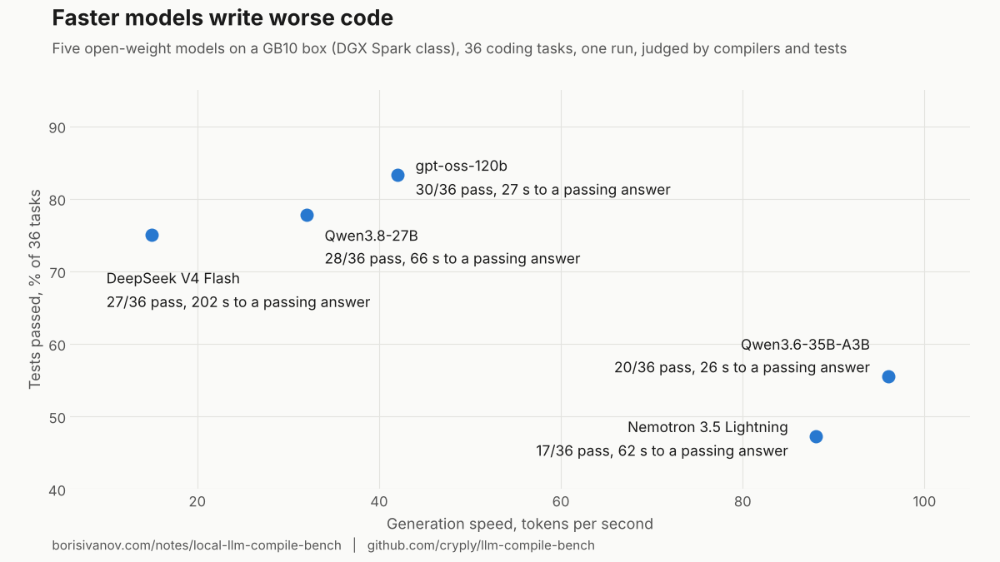

# llm-compile-bench

Does the code compile? A coding benchmark for local LLMs, judged by
compilers and tests instead of by eye.

Most local-LLM benchmarks report tokens per second. That answers *how fast*,
not *which model to install*. For a developer the second question reduces to
something a machine can check: does the generated code compile, and do the
tests pass? This harness asks exactly that, several times, and reports the
spread.



## What it does

- Six tasks, one per language: Rust, C++, Python, Go, TypeScript, React.
  Each task is a prompt with a fixed function signature and a hidden test.
  The prompts are written in Russian; the function signature and the
  hidden test are language-neutral, so a model that can read the signature
  can solve the task. Translating the prompts is a welcome PR.
- Each model gets the prompt through an OpenAI-compatible endpoint
  (Ollama, llama.cpp `llama-server`, anything else that speaks `/v1`).
- The answer is extracted, written next to the test, and judged by the real
  toolchain: `cargo build && cargo test`, `g++`, `pytest`, `go vet && go test`,
  `tsc --noEmit` (+ `tsx` for the TypeScript test).
- Every attempt is one CSV row: compile, tests, wall time, tokens, tok/s,
  reasoning length, error. `summary.py` turns one or many CSVs into a
  Markdown table with pass counts, wall median and min..max, time-to-pass,
  and which tasks are flaky across runs.

Results published so far are from a GB10 box (ASUS Ascent GX10, the DGX
Spark class, 128 GB unified memory): see `results/gb10/` and the write-up at
https://borisivanov.com/notes/local-llm-compile-bench/

## Quick start

Prerequisites on the box: Python 3.11+, and the judges you want to score with:
`cargo`, `g++`, `go`, `node`/`npx`, `pytest`. The script refuses to run if a
judge is missing, on purpose: a missing compiler looks exactly like a failing
model, and the first run of this project scored every Rust task zero for
that reason.

```
git clone https://github.com/cryply/llm-compile-bench && cd llm-compile-bench
python3 -m venv .venv && .venv/bin/pip install -r requirements.txt
(cd ts && npm install)          # TypeScript / React judges
cp models.example.yaml models.yaml   # edit: your endpoints and model names
.venv/bin/python3 run.py        # all models, all tasks
.venv/bin/python3 run.py -m qwen38 -p rust_iso8601   # one model, one task
.venv/bin/python3 summary.py results/results_*.csv    # table across runs
```

Run it five times for anything you intend to quote. One run is not a
measurement: in our data the single-run winner lost over five runs.

## Adding a model

`models.yaml`, one entry per model:

```yaml
models:
  qwen38:
    endpoint: http://localhost:11434/v1
    model: qwen3.8:27b
    after:  ["ollama stop qwen3.8:27b"]
  deepseek:
    endpoint: http://localhost:11436/v1
    model: deepseek-v4-flash
    exclusive: true                      # unload every other model first
    before: ["systemctl --user start llama-deepseek"]
    after:  ["systemctl --user stop llama-deepseek"]
```

`before`/`after` are shell commands on the box that runs the harness: how
you load and unload the model. They are yours; the ones in the example are
the author's systemd user units. `exclusive: true` runs every other model's
`after` first, which matters on unified-memory machines where two large
models side by side hang the box. `run.before`/`run.after` at the top level
run once per harness run: use them to stop anything else that might load a
model while the benchmark is running.

## Adding a task

One file in `prompts/`, for example `prompts/rust_iso8601.yaml`:

```yaml
lang: rust                 # rust | cpp | python | go | typescript | react
prompt: |
  Write a Rust function ... with exactly this signature ...
cargo_deps: ""             # rust only, appended to [dependencies]
files:
  test: |
    use bench::*;
    #[test] fn parses_date() { ... }
```

The prompt must pin the signature; the test is hidden from the model and
must not be guessable from the prompt. Keep tasks small enough that a correct
answer fits in a few thousand tokens, and set `request.max_tokens` high
enough for reasoning models (32000 here): a model that runs out of budget is
reported as `max_tokens exhausted`, not as a model that cannot code.

## Reading the results

`summary.py` prints one row per model:

| column | meaning |
|---|---|
| Compiles / Tests pass | attempts that built / passed, out of all attempts |
| Wall median, min..max | wall-clock per attempt; the spread is the point |
| Wall-to-pass | mean wall-clock over passing attempts only |
| tok/s | generation speed, for reference; it ranks models backwards here |
| Flaky tasks | tasks that passed in some runs and failed in others |

Failure classes recorded in the CSV `error` column: `no code block`,
`max_tokens exhausted`, `tests hang: <cmd>` (compiled, then the tests never
returned: a deadlock), compiler and test errors in the per-task `.log`.

## Layout

```
run.py          harness: preflight, model switching, prompting, judging
summary.py      table across one or many result files
models.yaml     your models (not committed); models.example.yaml is the template
prompts/        tasks
ts/             package.json + tsconfig for the TypeScript/React judges
results/        CSV per run; results/<hardware>/ for published sets
work/           scratch build dirs (ignored)
```

## Contributing results

Open a PR with your `results/<hardware>/results_*.csv` files (five runs,
please) and a line in `results/<hardware>/README.md` naming the machine,
memory, runtime versions and model files/quantizations. Model names in
`models.yaml` are free text; use the real model name and quant in the README
so tables are comparable.

## License

MIT.
